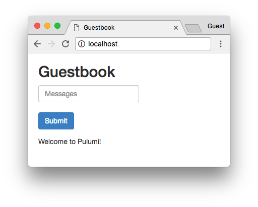

[](https://app.pulumi.com/new?template=https://github.com/pulumi/examples/blob/master/kubernetes-ts-guestbook/simple/README.md#gh-light-mode-only)
[](https://app.pulumi.com/new?template=https://github.com/pulumi/examples/blob/master/kubernetes-ts-guestbook/simple/README.md#gh-dark-mode-only)

# Kubernetes Guestbook (simple variant)

A version of the [Kubernetes Guestbook](https://kubernetes.io/docs/tutorials/stateless-application/guestbook/)
application using Pulumi.

This is a straight port of the original YAML, and doesn't highlight advantages of using real languages. For an example
using abstraction to cut down on boilerplate, please see the [variant using components](../components),
also in this repo. It provisions the same set of resources.

## Prerequisites

1. [Install Pulumi](https://www.pulumi.com/docs/get-started/install/)
2. [Configure Kubernetes](https://www.pulumi.com/docs/intro/cloud-providers/kubernetes/setup/)
3. [Install Node.js](https://www.pulumi.com/docs/intro/languages/javascript/)

> _Note_: the Pulumi CLI version is pinned in [`.tool-versions`](./.tool-versions) and managed with
> [asdf](https://asdf-vm.com/). Install that version with:
>
> ```bash
> asdf plugin add pulumi https://github.com/canha/asdf-pulumi.git
> asdf install
> ```

## Deploying the example

1.  Create a new stack:

    ```bash
    pulumi stack init dev
    ```

1.  This example will attempt to expose the Guestbook application to the Internet with a `Service` of
    type `LoadBalancer`. Since minikube does not support `LoadBalancer`, the Guestbook application
    already knows to use type `ClusterIP` instead; all you need to do is tell it whether you're
    deploying to minikube:

    ```bash
    pulumi config set isMinikube <value>
    ```

1.  Install dependencies:

    ```bash
    npm install
    ```

1.  Deploy the stack:

    ```bash
    pulumi up
    ```

    ```
    Updating stack 'testbook'
    Performing changes:

         Type                           Name                Status      Info
     +   pulumi:pulumi:Stack            guestbook-testbook  created
     +   ├─ kubernetes:apps:Deployment  redis-leader        created
     +   ├─ kubernetes:apps:Deployment  frontend            created
     +   ├─ kubernetes:apps:Deployment  redis-replica       created
     +   ├─ kubernetes:core:Service     redis-leader        created     1 info message
     +   ├─ kubernetes:core:Service     redis-replica       created     1 info message
     +   └─ kubernetes:core:Service     frontend            created     2 info messages

    ---outputs:---
    frontendIp: "35.232.147.18"

    info: 7 changes performed:
        + 7 resources created
    Update duration: 40.829381902s
    ```

1.  Open the application in your browser to see the running application. If you're running
    macOS you can simply run:

    ```bash
    open $(pulumi stack output frontendIp)
    ```

    > _Note_: minikube does not support type `LoadBalancer`; if you are deploying to minikube, make sure
    > to run `kubectl -n guestbook-dev port-forward svc/frontend 8080:80` to forward the cluster port to the local
    > machine and access the service via `localhost:8080`.

    

## Cleaning up

Once you're finished experimenting, you can destroy your stack and remove it to avoid incurring any additional cost:

```bash
pulumi destroy
pulumi stack rm
```

## Monitoring (Prometheus + Grafana)

The stack also deploys [kube-prometheus-stack](https://github.com/prometheus-community/helm-charts/tree/main/charts/kube-prometheus-stack)
(Prometheus, Grafana, kube-state-metrics) into the `monitoring` namespace. The Guestbook now runs in the
`guestbook-<stack>` namespace (e.g. `guestbook-dev`), and its frontend and Redis pods expose metrics through
sidecar exporters scraped by `ServiceMonitor`s.

**Exporters** (run as sidecars in each pod)

| Pod | Exporter | Metrics |
| --- | --- | --- |
| `redis-leader`, `redis-replica` | [`oliver006/redis_exporter`](https://github.com/oliver006/redis_exporter) | Redis commands, clients, memory |
| `frontend` | [`mtail`](https://github.com/jaqx0r/mtail) parsing the Apache access log (`monitoring/guestbook.mtail`) | requests by status code, latency |

Pod CPU/memory come from the kubelet (cAdvisor), and Kubernetes object state from kube-state-metrics.

> The minikube port-forward command above needs the namespace: `kubectl -n guestbook-dev port-forward svc/frontend 8080:80`.

**Grafana**

```bash
pulumi stack output grafanaUrl                       # URL
pulumi stack output grafanaUser                      # username
pulumi stack output grafanaPassword --show-secrets   # randomly generated password
```

**Prometheus**

```bash
kubectl -n monitoring port-forward svc/prometheus-operated 9090   # then open http://localhost:9090
```

**Dashboard**

Import [`grafana/Guestbook-external.json`](./grafana/Guestbook-external.json) in Grafana:
Dashboards → New → Import → upload the file → select the Prometheus data source.
